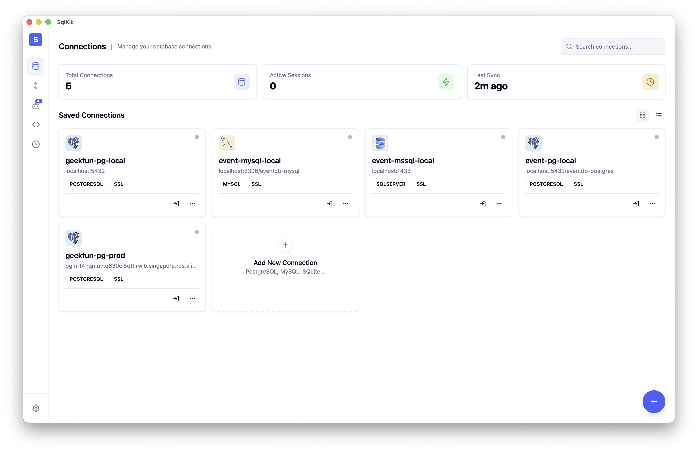

<div align="center">


# SqlKit

**Agentic cross-platform SQL database GUI client — your database agent for 70+ databases.**

**Privacy-first. Your data, your keys. Open source.**

[](https://github.com/geek-fun/sqlkit/releases)
[](https://github.com/geek-fun/sqlkit/releases)
[](LICENSE)
[](https://github.com/geek-fun/sqlkit/stargazers)
[](https://github.com/geek-fun/sqlkit/actions/workflows/node.yml)
[](https://mcptoplist.com/server/io.github.geek-fun%2Fdata-studio)

<p>
  
  
  
  
  
</p>

[Download](https://www.geekfun.club/download) · [Docs](docs/DISTRIBUTION.md) · [Website](https://www.geekfun.club) · [Releases](https://github.com/geek-fun/sqlkit/releases)

English · [简体中文](README_zh.md)

</div>

---

SqlKit is an **agentic database client** — it doesn't just execute SQL, it understands your databases and acts on your behalf. Describe what you need in natural language and the agent writes queries, inspects schemas, optimizes SQL, and returns results. Built on Tauri (Rust), not Electron, it replaces heavyweight clients like DBeaver, Navicat, and DataGrip with a single native desktop app.

<p align="center">
  
</p>

<p align="center">
  
  
  
  
  
  
  
  
  <br/>
  
  
  
  
  
  
  
  
  <br/>
  
  
  
  
  
  
  
  
  
  <br/>
  
  
  
  
  
  
  
  
  <br/>
  
  
  
  
  
  
  
  
  <br/>
  
  
  
  
  
  
  
  
  <br/>
  
  
  
  
  
  
  
  
  <br/>
  
  
  
  
  
  
  
  
  
  
</p>

## Installation

<a href="https://www.geekfun.club/download">
  <picture>
    <source media="(prefers-color-scheme: dark)" srcset="https://img.shields.io/badge/Download-macOS_|_Windows_|_Linux-orange?logo=download&logoColor=white">
    
  </picture>
</a>
&nbsp;
<a href="https://github.com/geek-fun/sqlkit/releases">
  
</a>
&nbsp;
<a href="https://www.geekfun.club/products/sqlkit/">
  
</a>

## Features

### Agentic Data Studio

Describe what you need in natural language — the agent reads your schema, writes queries, optimizes slow SQL, explains execution plans visually, and fixes errors on the spot. Supports OpenAI, Anthropic, DeepSeek, and Ollama. Bring your own key.

- **AI query generation** — natural language to SQL with schema-aware context
- **SQL optimization** — rewrite slow queries and visualize execution plans
- **Error fixing** — agent diagnoses and fixes SQL errors automatically
- **Safety** — destructive operations require confirmation; credentials never exposed to the LLM

### Lightweight & Native Performance

Built with Rust + Tauri v2 — no Electron, no JRE, no bundled Chromium. Ships as a small native binary with native performance across macOS, Windows, and Linux. What other apps need a Java runtime or a JetBrains license for, SqlKit does in a single download.

### All Your Databases, One App

SqlKit supports **70+ databases** across four adapter strategies:

| Strategy | Databases |
|----------|-----------|
| **Native** (Rust) | PostgreSQL, MySQL, SQL Server, SQLite |
| **PG-wire compat** | CockroachDB, Redshift, YugabyteDB, TimescaleDB, QuestDB, Vastbase, YashanDB, KingbaseES, GaussDB, HighGo, UXDB, OpenGauss, GBase8c, Greenplum, EnterpriseDB, CrateDB, Materialize, AlloyDB, CloudSQLPG, FujitsuPG |
| **MySQL-wire compat** | MariaDB, TiDB, OceanBase, TDSQL, PolarDB, Doris, SelectDB, StarRocks, Databend, GoldenDB, ManticoreSearch, SingleStore, CloudSQLMySQL |
| **JDBC bridge** | Oracle, DuckDB, Firebird, DB2, H2, Snowflake, TDengine, Derby, Hive, Databricks, Hana, Teradata, Vertica, Exasol, BigQuery, Informix, Kylin, Cassandra, Iris, Access, Dameng, XuguDB, GBase8a |
| **HTTP bridge** | ClickHouse, Trino, Presto, RQLite, Turso |

### Product-Grade Editor

Powered by Monaco (VS Code engine) with full SQL syntax highlighting, autocomplete, and multi-tab support. Browse schemas visually, inspect DDL, and search objects across databases.

- **Monaco Editor** — VS Code-grade SQL editing with syntax highlighting and autocomplete
- **Multi-tab** — work on multiple queries simultaneously with tab management
- **Schema Browser** — tree view of databases, schemas, tables, columns, indexes
- **Query history** — auto-saved, searchable, replayable
- **Results grid** — paginated, sortable, with inline editing and CSV/JSON/Markdown export
- **DDL viewer** — view CREATE statements for any object
- **Object search** — quickly find tables, views, and procedures across schemas

### Large Data Transfer

Move data between any supported engines — PostgreSQL to ClickHouse, Oracle to SQL Server, or MySQL to BigQuery. No intermediate files required.

- **Cross-engine transfer** — migrate data between different database types with automatic type mapping
- **Import / Export** — CSV, JSON, JSONL formats
- **Bulk operations** — handle millions of records with batch processing

### Security & Connectivity

- **SSH Tunnel** — connect through SSH with key or password authentication
- **Encrypted storage** — credentials secured by OS keychain (macOS Keychain, Windows Credential Manager, Linux Secret Service)
- **SSL/TLS** — encrypted connections to supported databases
- **Auto-reconnect** — resilient connection handling

### Cross-Platform

- **macOS** (Apple Silicon & Intel) — native `.dmg` installer
- **Windows** — `.exe` installer
- **Linux** — `.AppImage` and `.deb` packages

## Development

### Prerequisites

- [Node.js](https://nodejs.org/) >= 18
- [Rust toolchain](https://www.rust-lang.org/tools/install)

**Linux (Ubuntu/Debian):**

```bash
sudo apt-get install -y libgtk-3-dev libwebkit2gtk-4.1-dev libayatana-appindicator3-dev librsvg2-dev libssl-dev
```

**macOS:**

```bash
xcode-select --install
```

**Windows:** Install [Microsoft C++ Build Tools](https://visualstudio.microsoft.com/visual-cpp-build-tools/)

### Quick Start

```bash
npm install
npm run tauri dev
```

### Scripts

| Command | Description |
|---------|-------------|
| `npm run dev` | Start Vite dev server |
| `npm run build` | Build frontend for production |
| `npm run lint:check` | Run ESLint |
| `npm run lint:fix` | Auto-fix lint issues |
| `npm test` | Run frontend tests |
| `npm run tauri dev` | Start Tauri development |
| `npm run tauri build` | Build Tauri application |

### Build Instructions

See [BUILD.md](BUILD.md) for detailed platform-specific build requirements and troubleshooting.

## Tech Stack

| Layer | Technology |
|-------|------------|
| Framework | [Tauri v2](https://tauri.app/) (Rust) |
| Frontend | [Vue 3](https://vuejs.org/) + [TypeScript](https://www.typescriptlang.org/) |
| UI | [shadcn-vue](https://www.shadcn-vue.com/) + [UnoCSS](https://unocss.dev/) |
| Editor | [Monaco Editor](https://microsoft.github.io/monaco-editor/) |
| Database | [sqlx](https://github.com/launchbadge/sqlx) + engine-specific drivers |

## FAQ

<details>
<summary><strong>Is SqlKit free?</strong></summary>

Yes — the **Community edition** is free and open source under the Apache 2.0 license. Connections, SQL editing, schema browsing, data editing, query history and result export are all free, with no artificial limits.

Advanced capabilities — AI agent (bring your own LLM), MCP server, ER diagrams, bulk import/export and cross-engine data transfer — are part of the paid **GEEKFUN Data Studio Ultimate** subscription ($9.9/month or $99/year, with a 7-day free trial). Every version released while you're subscribed stays yours forever, even if you cancel later.

[See pricing →](https://www.geekfun.club/pricing)
</details>

<details>
<summary><strong>Does SqlKit phone home?</strong></summary>
No. SqlKit does not collect telemetry. The auto-update feature checks GitHub Releases for new versions — you can disable it in settings. Your credentials and queries stay on your machine.
</details>

<details>
<summary><strong>Can I use SqlKit without an internet connection?</strong></summary>
Yes. The desktop app works fully offline. AI features require network access to the model endpoint (or a local model via Ollama).
</details>

<details>
<summary><strong>How is SqlKit different from DBeaver / TablePlus / DataGrip?</strong></summary>
SqlKit is a native Tauri app (Rust) — no Java JRE, no Electron overhead. It includes AI natively (not as a plugin), supports 70+ databases, and runs on macOS, Windows, and Linux from a single binary. Privacy-first with encrypted local credential storage.
</details>

<details>
<summary><strong>What databases are supported?</strong></summary>
PostgreSQL, MySQL, Oracle, SQL Server, SQLite, DuckDB, ClickHouse, Firebird, MariaDB, CockroachDB, TiDB, OceanBase, Snowflake, DB2, H2, Trino, Greenplum, CrateDB, SingleStore, and 60+ more. See the <a href="#multi-database-support">Multi-Database Support</a> section for the full list.
</details>

<details>
<summary><strong>How do I report a bug or request a feature?</strong></summary>
Open an issue on <a href="https://github.com/geek-fun/sqlkit/issues">GitHub Issues</a>.
</details>

## Community

<p align="center">
  
</p>

<p align="center">
  <a href="https://x.com/geekfun_club"></a>
  &nbsp;&nbsp;&nbsp;
  <a href="https://www.youtube.com/@geekfun-club"></a>
  &nbsp;&nbsp;&nbsp;
  <a href="https://github.com/geek-fun"></a>
</p>

## Sponsor

<p align="center">
  
  &nbsp;&nbsp;&nbsp;&nbsp;&nbsp;
  <a href="https://github.com/sponsors/geek-fun"></a>
</p>

## License

[Apache 2.0](LICENSE) © GEEKFUN
