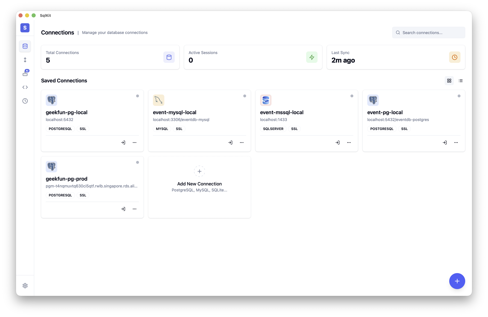

<div align="center">


# SqlKit

**Cliente GUI de bases de datos SQL agéntico y multiplataforma — tu agente de bases de datos para más de 70 bases de datos.**

**Privacidad primero. Tus datos, tus llaves. Código abierto.**

[](https://github.com/geek-fun/sqlkit/releases)
[](https://github.com/geek-fun/sqlkit/releases)
[](LICENSE)
[](https://github.com/geek-fun/sqlkit/stargazers)
[](https://github.com/geek-fun/sqlkit/actions/workflows/node.yml)
[](https://mcptoplist.com/server/io.github.geek-fun%2Fdata-studio)

<p>
  
  
  
  
  
</p>

[Descargar](https://www.geekfun.club/download) · [Documentación](docs/DISTRIBUTION.md) · [Sitio web](https://www.geekfun.club) · [Versiones](https://github.com/geek-fun/sqlkit/releases)

[English](README.md) · [简体中文](README_zh.md) · [Português (BR)](README_pt-BR.md) · [日本語](README_ja.md) · [한국어](README_ko.md) · Español

</div>

---

SqlKit es un **cliente de bases de datos agéntico** — no solo ejecuta SQL, sino que entiende tus bases de datos y actúa en tu nombre. Describe lo que necesitas en lenguaje natural y el agente escribe consultas, inspecciona esquemas, optimiza SQL y devuelve resultados. Construido con Tauri (Rust), no con Electron, reemplaza a clientes pesados como DBeaver, Navicat y DataGrip con una única app de escritorio nativa.

<p align="center">
  
</p>

<p align="center">
  
  
  
  
  
  
  
  
  <br/>
  
  
  
  
  
  
  
  
  <br/>
  
  
  
  
  
  
  
  
  
  <br/>
  
  
  
  
  
  
  
  
  <br/>
  
  
  
  
  
  
  
  
  <br/>
  
  
  
  
  
  
  
  
  <br/>
  
  
  
  
  
  
  
  
  <br/>
  
  
  
  
  
  
  
  
  
  
</p>

## Instalación

<a href="https://www.geekfun.club/download">
  <picture>
    <source media="(prefers-color-scheme: dark)" srcset="https://img.shields.io/badge/Download-macOS_|_Windows_|_Linux-orange?logo=download&logoColor=white">
    
  </picture>
</a>
&nbsp;
<a href="https://github.com/geek-fun/sqlkit/releases">
  
</a>
&nbsp;
<a href="https://www.geekfun.club/products/sqlkit/">
  
</a>

## Características

### Estudio de Datos Agéntico

Describe lo que necesitas en lenguaje natural — el agente lee tu esquema, escribe consultas, optimiza el SQL lento, explica los planes de ejecución visualmente y corrige errores al instante. Compatible con OpenAI, Anthropic, DeepSeek y Ollama. Trae tu propia clave.

- **Generación de consultas con IA** — de lenguaje natural a SQL con contexto consciente del esquema
- **Optimización de SQL** — reescribe consultas lentas y visualiza planes de ejecución
- **Corrección de errores** — el agente diagnostica y corrige errores de SQL automáticamente
- **Seguridad** — las operaciones destructivas requieren confirmación; las credenciales nunca se exponen al LLM

### Ligero y con rendimiento nativo

Construido con Rust + Tauri v2 — sin Electron, sin JRE, sin Chromium incluido. Se distribuye como un pequeño binario nativo, con rendimiento nativo en macOS, Windows y Linux. Lo que otras apps necesitan un runtime de Java o una licencia de JetBrains para hacer, SqlKit lo hace con una sola descarga.

### Todas tus bases de datos, una sola app

SqlKit es compatible con **más de 70 bases de datos** mediante cuatro estrategias de adaptador:

| Estrategia | Bases de datos |
|----------|-----------|
| **Nativo** (Rust) | PostgreSQL, MySQL, SQL Server, SQLite |
| **Compatible con protocolo PG** | CockroachDB, Redshift, YugabyteDB, TimescaleDB, QuestDB, Vastbase, YashanDB, KingbaseES, GaussDB, HighGo, UXDB, OpenGauss, GBase8c, Greenplum, EnterpriseDB, CrateDB, Materialize, AlloyDB, CloudSQLPG, FujitsuPG |
| **Compatible con protocolo MySQL** | MariaDB, TiDB, OceanBase, TDSQL, PolarDB, Doris, SelectDB, StarRocks, Databend, GoldenDB, ManticoreSearch, SingleStore, CloudSQLMySQL |
| **Puente JDBC** | Oracle, DuckDB, Firebird, DB2, H2, Snowflake, TDengine, Derby, Hive, Databricks, Hana, Teradata, Vertica, Exasol, BigQuery, Informix, Kylin, Cassandra, Iris, Access, Dameng, XuguDB, GBase8a |
| **Puente HTTP** | ClickHouse, Trino, Presto, RQLite, Turso |

### Editor de calidad profesional

Impulsado por Monaco (el motor de VS Code), ofrece resaltado de sintaxis SQL completo, autocompletado y soporte para múltiples pestañas. Explora esquemas visualmente, inspecciona el DDL y busca objetos en todas las bases de datos.

- **Editor Monaco** — edición de SQL de nivel VS Code con resaltado de sintaxis y autocompletado
- **Múltiples pestañas** — trabaja en varias consultas a la vez con gestión de pestañas
- **Explorador de esquemas** — vista de árbol de bases de datos, esquemas, tablas, columnas e índices
- **Historial de consultas** — se guarda automáticamente, se puede buscar y repetir
- **Cuadrícula de resultados** — paginada, ordenable, con edición en línea y exportación a CSV/JSON/Markdown
- **Visor de DDL** — consulta las sentencias CREATE de cualquier objeto
- **Búsqueda de objetos** — encuentra rápidamente tablas, vistas y procedimientos en los esquemas

### Transferencia de grandes volúmenes de datos

Mueve datos entre cualquier motor compatible — de PostgreSQL a ClickHouse, de Oracle a SQL Server o de MySQL a BigQuery. Sin archivos intermedios.

- **Transferencia entre motores** — migra datos entre diferentes tipos de bases de datos con mapeo automático de tipos
- **Importación / Exportación** — formatos CSV, JSON y JSONL
- **Operaciones masivas** — procesa millones de registros con procesamiento por lotes

### Seguridad y conectividad

- **Túnel SSH** — conéctate a través de SSH con autenticación por clave o contraseña
- **Almacenamiento cifrado** — credenciales protegidas por el llavero del sistema operativo (macOS Keychain, Windows Credential Manager, Linux Secret Service)
- **SSL/TLS** — conexiones cifradas a las bases de datos compatibles
- **Reconexión automática** — gestión de conexiones resiliente

### Multiplataforma

- **macOS** (Apple Silicon e Intel) — instalador nativo `.dmg`
- **Windows** — instalador `.exe`
- **Linux** — paquetes `.AppImage` y `.deb`

## Desarrollo

### Requisitos previos

- [Node.js](https://nodejs.org/) >= 18
- [Toolchain de Rust](https://www.rust-lang.org/tools/install)

**Linux (Ubuntu/Debian):**

```bash
sudo apt-get install -y libgtk-3-dev libwebkit2gtk-4.1-dev libayatana-appindicator3-dev librsvg2-dev libssl-dev
```

**macOS:**

```bash
xcode-select --install
```

**Windows:** Instala [Microsoft C++ Build Tools](https://visualstudio.microsoft.com/visual-cpp-build-tools/)

### Inicio rápido

```bash
npm install
npm run tauri dev
```

### Scripts

| Comando | Descripción |
|---------|-------------|
| `npm run dev` | Inicia el servidor de desarrollo de Vite |
| `npm run build` | Compila el frontend para producción |
| `npm run lint:check` | Ejecuta ESLint |
| `npm run lint:fix` | Corrige automáticamente los problemas de lint |
| `npm test` | Ejecuta las pruebas del frontend |
| `npm run tauri dev` | Inicia el desarrollo con Tauri |
| `npm run tauri build` | Compila la aplicación Tauri |

### Instrucciones de compilación

Consulta [BUILD.md](BUILD.md) para ver los requisitos de compilación específicos de cada plataforma y la solución de problemas.

## Stack tecnológico

| Capa | Tecnología |
|-------|------------|
| Framework | [Tauri v2](https://tauri.app/) (Rust) |
| Frontend | [Vue 3](https://vuejs.org/) + [TypeScript](https://www.typescriptlang.org/) |
| UI | [shadcn-vue](https://www.shadcn-vue.com/) + [UnoCSS](https://unocss.dev/) |
| Editor | [Monaco Editor](https://microsoft.github.io/monaco-editor/) |
| Base de datos | [sqlx](https://github.com/launchbadge/sqlx) + drivers específicos de cada motor |

## Preguntas frecuentes

<details>
<summary><strong>¿Es SqlKit gratuito?</strong></summary>

Sí — la **edición Community** es gratuita y de código abierto bajo la licencia Apache 2.0. Las conexiones, la edición de SQL, la exploración de esquemas, la edición de datos, el historial de consultas y la exportación de resultados son gratuitos, sin límites artificiales.

Las capacidades avanzadas — agente de IA (con tu propio LLM), servidor MCP, diagramas ER, importación/exportación masiva y transferencia de datos entre motores — forman parte de la suscripción de pago **GEEKFUN Data Studio Ultimate** (9,9 USD/mes o 99 USD/año, con 7 días de prueba gratuita). Todas las versiones publicadas mientras tu suscripción esté activa quedan tuyas para siempre, incluso si cancelas más adelante.

[Ver precios →](https://www.geekfun.club/pricing)
</details>

<details>
<summary><strong>¿SqlKit envía datos a servidores externos?</strong></summary>
No. SqlKit no recopila telemetría. La función de actualización automática consulta GitHub Releases en busca de nuevas versiones — puedes desactivarla en la configuración. Tus credenciales y consultas permanecen en tu equipo.
</details>

<details>
<summary><strong>¿Puedo usar SqlKit sin conexión a internet?</strong></summary>
Sí. La app de escritorio funciona completamente sin conexión. Las funciones de IA requieren acceso de red al endpoint del modelo (o un modelo local mediante Ollama).
</details>

<details>
<summary><strong>¿En qué se diferencia SqlKit de DBeaver / TablePlus / DataGrip?</strong></summary>
SqlKit es una app nativa de Tauri (Rust) — sin Java JRE, sin la sobrecarga de Electron. Incluye IA de forma nativa (no como plugin), es compatible con más de 70 bases de datos y funciona en macOS, Windows y Linux desde un único binario. Privacidad primero, con almacenamiento local cifrado de credenciales.
</details>

<details>
<summary><strong>¿Qué bases de datos son compatibles?</strong></summary>
PostgreSQL, MySQL, Oracle, SQL Server, SQLite, DuckDB, ClickHouse, Firebird, MariaDB, CockroachDB, TiDB, OceanBase, Snowflake, DB2, H2, Trino, Greenplum, CrateDB, SingleStore y más de 60 adicionales. Consulta la sección <a href="#multi-database-support">Soporte de múltiples bases de datos</a> para ver la lista completa.
</details>

<details>
<summary><strong>¿Cómo puedo reportar un error o solicitar una nueva función?</strong></summary>
Abre un issue en <a href="https://github.com/geek-fun/sqlkit/issues">GitHub Issues</a>.
</details>

## Comunidad

<p align="center">
  
</p>

<p align="center">
  <a href="https://x.com/geekfun_club"></a>
  &nbsp;&nbsp;&nbsp;
  <a href="https://www.youtube.com/@geekfun-club"></a>
  &nbsp;&nbsp;&nbsp;
  <a href="https://github.com/geek-fun"></a>
</p>

## Patrocinio

<p align="center">
  
  &nbsp;&nbsp;&nbsp;&nbsp;&nbsp;
  <a href="https://github.com/sponsors/geek-fun"></a>
</p>

## Licencia

[Apache 2.0](LICENSE) © GEEKFUN
