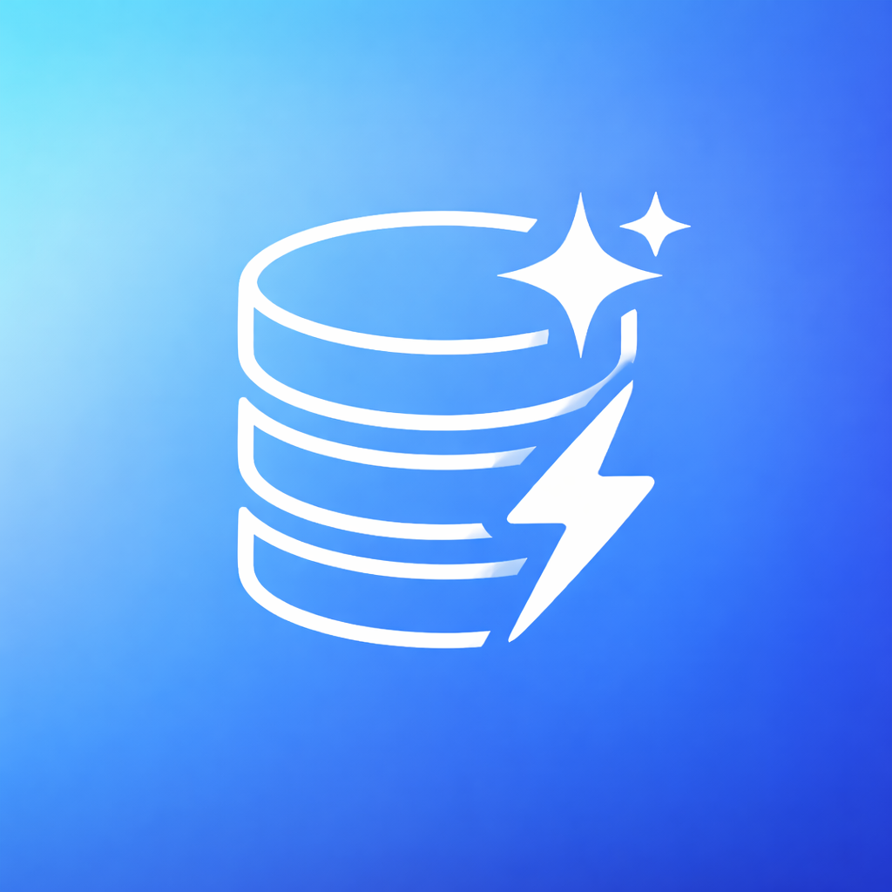
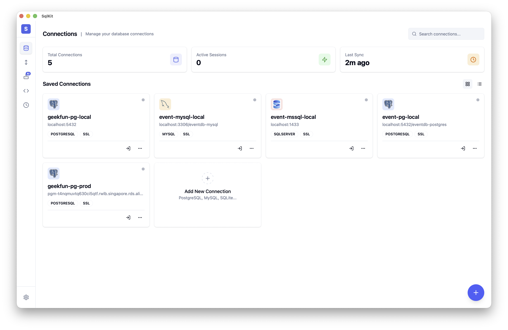

<div align="center">



# SqlKit

**Agentic なクロスプラットフォーム SQL データベース GUI クライアント — 70 以上のデータベースに対応する、あなたのデータベースエージェント。**

**プライバシー第一。あなたのデータ、あなたのキー。オープンソース。**

[](https://github.com/geek-fun/sqlkit/releases)
[](https://github.com/geek-fun/sqlkit/releases)
[](LICENSE)
[](https://github.com/geek-fun/sqlkit/stargazers)
[](https://github.com/geek-fun/sqlkit/actions/workflows/node.yml)
[](https://mcptoplist.com/server/io.github.geek-fun%2Fdata-studio)

<p>
  
  
  
  
  
</p>

[ダウンロード](https://www.geekfun.club/download) · [ドキュメント](docs/DISTRIBUTION.md) · [ウェブサイト](https://www.geekfun.club) · [リリース](https://github.com/geek-fun/sqlkit/releases)

[English](README.md) · [简体中文](README_zh.md) · [Português (BR)](README_pt-BR.md) · 日本語 · [한국어](README_ko.md) · [Español](README_es.md)

</div>

---

SqlKit は **Agentic なデータベースクライアント** です — 単に SQL を実行するだけではなく、あなたのデータベースを理解し、あなたに代わって操作します。必要なことを自然言語で伝えれば、エージェントがクエリを書き、スキーマを調査し、SQL を最適化して結果を返します。Electron ではなく Tauri（Rust）で構築されており、DBeaver、Navicat、DataGrip といった重厚なクライアントを 1 つのネイティブデスクトップアプリに置き換えます。

<p align="center">
  
</p>

<p align="center">
  
  
  
  
  
  
  
  
  <br/>
  
  
  
  
  
  
  
  
  <br/>
  
  
  
  
  
  
  
  
  
  <br/>
  
  
  
  
  
  
  
  
  <br/>
  
  
  
  
  
  
  
  
  <br/>
  
  
  
  
  
  
  
  
  <br/>
  
  
  
  
  
  
  
  
  <br/>
  
  
  
  
  
  
  
  
  
  
</p>

## インストール

<a href="https://www.geekfun.club/download">
  <picture>
    <source media="(prefers-color-scheme: dark)" srcset="https://img.shields.io/badge/Download-macOS_|_Windows_|_Linux-orange?logo=download&logoColor=white">
    
  </picture>
</a>
&nbsp;
<a href="https://github.com/geek-fun/sqlkit/releases">
  
</a>
&nbsp;
<a href="https://www.geekfun.club/products/sqlkit/">
  
</a>

## 機能

### Agentic データスタジオ

必要なことを自然言語で記述するだけです — エージェントがスキーマを読み取り、クエリを書き、遅い SQL を最適化し、実行プランをわかりやすく可視化し、エラーをその場で修正します。OpenAI、Anthropic、DeepSeek、Ollama に対応。API キーはご自身のものをご利用ください。

- **AI クエリ生成** — スキーマを把握したコンテキストで自然言語から SQL を生成
- **SQL 最適化** — 遅いクエリを書き換え、実行プランを可視化
- **エラー修正** — エージェントが SQL エラーを自動で診断・修正
- **安全性** — 破壊的な操作には確認が必要。認証情報が LLM に渡されることはありません

### 軽量でネイティブなパフォーマンス

Rust + Tauri v2 で構築 — Electron も JRE もバンドルされた Chromium もありません。小さなネイティブバイナリとして提供され、macOS、Windows、Linux でネイティブのパフォーマンスを発揮します。他のアプリなら Java ランタイムや JetBrains ライセンスを必要とする処理も、SqlKit なら 1 回のダウンロードで実現します。

### すべてのデータベースを 1 つのアプリで

SqlKit は 4 つのアダプタ戦略によって **70 以上のデータベース** に対応しています:

| 戦略 | データベース |
|----------|-----------|
| **ネイティブ** (Rust) | PostgreSQL, MySQL, SQL Server, SQLite |
| **PG プロトコル互換** | CockroachDB, Redshift, YugabyteDB, TimescaleDB, QuestDB, Vastbase, YashanDB, KingbaseES, GaussDB, HighGo, UXDB, OpenGauss, GBase8c, Greenplum, EnterpriseDB, CrateDB, Materialize, AlloyDB, CloudSQLPG, FujitsuPG |
| **MySQL プロトコル互換** | MariaDB, TiDB, OceanBase, TDSQL, PolarDB, Doris, SelectDB, StarRocks, Databend, GoldenDB, ManticoreSearch, SingleStore, CloudSQLMySQL |
| **JDBC ブリッジ** | Oracle, DuckDB, Firebird, DB2, H2, Snowflake, TDengine, Derby, Hive, Databricks, Hana, Teradata, Vertica, Exasol, BigQuery, Informix, Kylin, Cassandra, Iris, Access, Dameng, XuguDB, GBase8a |
| **HTTP ブリッジ** | ClickHouse, Trino, Presto, RQLite, Turso |

### プロダクトグレードのエディター

Monaco（VS Code エンジン）を搭載し、完全な SQL シンタックスハイライト、自動補完、マルチタブをサポートします。スキーマを視覚的に閲覧し、DDL を確認し、データベースを横断してオブジェクトを検索できます。

- **Monaco Editor** — シンタックスハイライトと自動補完を備えた VS Code グレードの SQL 編集
- **マルチタブ** — タブ管理で複数のクエリを同時に処理
- **スキーマブラウザー** — データベース、スキーマ、テーブル、カラム、インデックスのツリービュー
- **クエリ履歴** — 自動保存、検索可能、再実行可能
- **結果グリッド** — ページネーション、ソート、インライン編集、CSV/JSON/Markdown エクスポートに対応
- **DDL ビューアー** — 任意のオブジェクトの CREATE 文を表示
- **オブジェクト検索** — スキーマを横断してテーブル、ビュー、プロシージャをすばやく検索

### 大量データ転送

対応する任意のエンジン間でデータを移動できます — PostgreSQL から ClickHouse へ、Oracle から SQL Server へ、MySQL から BigQuery へ。中間ファイルは不要です。

- **クロスエンジン転送** — 異なる種類のデータベース間でデータを移行、型のマッピングは自動
- **インポート / エクスポート** — CSV、JSON、JSONL 形式に対応
- **バルク操作** — バッチ処理で数百万件のレコードを処理

### セキュリティと接続

- **SSH トンネル** — 鍵またはパスワード認証による SSH 接続
- **暗号化ストレージ** — 認証情報は OS のキーチェーンで保護（macOS Keychain、Windows Credential Manager、Linux Secret Service）
- **SSL/TLS** — 対応データベースへの暗号化接続
- **自動再接続** — 堅牢な接続管理

### クロスプラットフォーム

- **macOS**（Apple Silicon と Intel）— ネイティブの `.dmg` インストーラー
- **Windows** — `.exe` インストーラー
- **Linux** — `.AppImage` と `.deb` パッケージ

## 開発

### 前提条件

- [Node.js](https://nodejs.org/) >= 18
- [Rust ツールチェーン](https://www.rust-lang.org/tools/install)

**Linux (Ubuntu/Debian):**

```bash
sudo apt-get install -y libgtk-3-dev libwebkit2gtk-4.1-dev libayatana-appindicator3-dev librsvg2-dev libssl-dev
```

**macOS:**

```bash
xcode-select --install
```

**Windows:** [Microsoft C++ Build Tools](https://visualstudio.microsoft.com/visual-cpp-build-tools/) をインストールしてください

### クイックスタート

```bash
npm install
npm run tauri dev
```

### スクリプト

| コマンド | 説明 |
|---------|-------------|
| `npm run dev` | Vite 開発サーバーを起動 |
| `npm run build` | フロントエンドの本番用ビルド |
| `npm run lint:check` | ESLint を実行 |
| `npm run lint:fix` | Lint の問題を自動修正 |
| `npm test` | フロントエンドのテストを実行 |
| `npm run tauri dev` | Tauri 開発モードを起動 |
| `npm run tauri build` | Tauri アプリケーションをビルド |

### ビルド手順

プラットフォームごとのビルド要件とトラブルシューティングの詳細は [BUILD.md](BUILD.md) を参照してください。

## 技術スタック

| レイヤー | 技術 |
|-------|------------|
| フレームワーク | [Tauri v2](https://tauri.app/) (Rust) |
| フロントエンド | [Vue 3](https://vuejs.org/) + [TypeScript](https://www.typescriptlang.org/) |
| UI | [shadcn-vue](https://www.shadcn-vue.com/) + [UnoCSS](https://unocss.dev/) |
| エディター | [Monaco Editor](https://microsoft.github.io/monaco-editor/) |
| データベース | [sqlx](https://github.com/launchbadge/sqlx) + エンジン固有のドライバー |

## よくある質問

<details>
<summary><strong>SqlKit は無料ですか？</strong></summary>

はい — **Community エディション**は Apache 2.0 ライセンスの下で無料かつオープンソースです。接続、SQL 編集、スキーマ閲覧、データ編集、クエリ履歴、結果のエクスポートはすべて無料で、人為的な制限はありません。

高度な機能 — AI エージェント（お使いの LLM を利用）、MCP サーバー、ER 図、一括インポート/エクスポート、クロスエンジンデータ転送 — は、有料の **GEEKFUN Data Studio Ultimate** サブスクリプション（月額 $9.9 または年額 $99、7 日間の無料トライアル付き）の一部です。サブスクリプション期間中にリリースされたバージョンは、後で解約しても永久にあなたのものです。

[料金を見る →](https://www.geekfun.club/pricing)
</details>

<details>
<summary><strong>SqlKit はデータを外部に送信しますか？</strong></summary>
いいえ。SqlKit はテレメトリーを収集しません。自動更新機能は GitHub Releases で新しいバージョンを確認します — 設定から無効化できます。認証情報とクエリはあなたのマシンから出ることはありません。
</details>

<details>
<summary><strong>インターネット接続なしで SqlKit を使えますか？</strong></summary>
はい。デスクトップアプリは完全にオフラインで動作します。AI 機能にはモデルエンドポイントへのネットワークアクセス（または Ollama によるローカルモデル）が必要です。
</details>

<details>
<summary><strong>SqlKit は DBeaver / TablePlus / DataGrip と何が違いますか？</strong></summary>
SqlKit はネイティブの Tauri アプリ（Rust）です — Java JRE も Electron のオーバーヘッドもありません。AI をプラグインではなくネイティブに搭載し、70 以上のデータベースに対応し、1 つのバイナリで macOS、Windows、Linux 上で動作します。プライバシー第一、認証情報はローカルで暗号化して保存されます。
</details>

<details>
<summary><strong>対応しているデータベースは何ですか？</strong></summary>
PostgreSQL、MySQL、Oracle、SQL Server、SQLite、DuckDB、ClickHouse、Firebird、MariaDB、CockroachDB、TiDB、OceanBase、Snowflake、DB2、H2、Trino、Greenplum、CrateDB、SingleStore、その他 60 以上。完全なリストは<a href="#multi-database-support">マルチデータベース対応</a>のセクションを参照してください。
</details>

<details>
<summary><strong>バグの報告や機能のリクエストはどのように行えばよいですか？</strong></summary>
<a href="https://github.com/geek-fun/sqlkit/issues">GitHub Issues</a> で issue をオープンしてください。
</details>

## コミュニティ

<p align="center">
  
</p>

<p align="center">
  <a href="https://x.com/geekfun_club"></a>
  &nbsp;&nbsp;&nbsp;
  <a href="https://www.youtube.com/@geekfun-club"></a>
  &nbsp;&nbsp;&nbsp;
  <a href="https://github.com/geek-fun"></a>
</p>

## スポンサー

<p align="center">
  
  &nbsp;&nbsp;&nbsp;&nbsp;&nbsp;
  <a href="https://github.com/sponsors/geek-fun"></a>
</p>

## ライセンス

[Apache 2.0](LICENSE) © GEEKFUN
