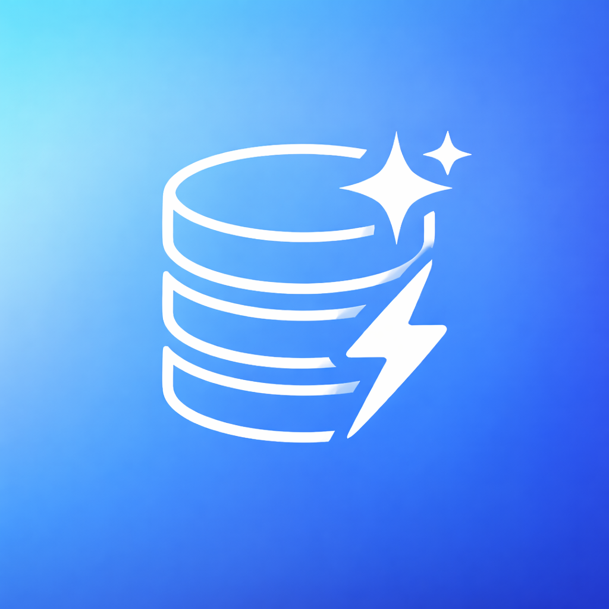
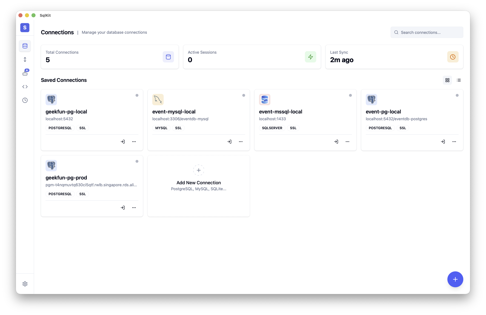

<div align="center">



# SqlKit

**Agentic 크로스플랫폼 SQL 데이터베이스 GUI 클라이언트 — 70개 이상의 데이터베이스를 지원하는 여러분의 데이터베이스 에이전트.**

**프라이버시 최우선. 여러분의 데이터, 여러분의 키. 오픈 소스.**

[](https://github.com/geek-fun/sqlkit/releases)
[](https://github.com/geek-fun/sqlkit/releases)
[](LICENSE)
[](https://github.com/geek-fun/sqlkit/stargazers)
[](https://github.com/geek-fun/sqlkit/actions/workflows/node.yml)
[](https://mcptoplist.com/server/io.github.geek-fun%2Fdata-studio)

<p>
  
  
  
  
  
</p>

[다운로드](https://www.geekfun.club/download) · [문서](docs/DISTRIBUTION.md) · [웹사이트](https://www.geekfun.club) · [릴리스](https://github.com/geek-fun/sqlkit/releases)

[English](README.md) · [简体中文](README_zh.md) · [Português (BR)](README_pt-BR.md) · [日本語](README_ja.md) · 한국어 · [Español](README_es.md)

</div>

---

SqlKit은 **Agentic 데이터베이스 클라이언트**입니다 — 단순히 SQL을 실행하는 데 그치지 않고, 여러분의 데이터베이스를 이해하고 대신 작업을 수행합니다. 필요한 것을 자연어로 설명하면 에이전트가 쿼리를 작성하고, 스키마를 검사하고, SQL을 최적화하여 결과를 반환합니다. Electron이 아닌 Tauri(Rust) 기반으로 구축되어 DBeaver, Navicat, DataGrip 같은 무거운 클라이언트를 하나의 네이티브 데스크톱 앱으로 대체합니다.

<p align="center">
  
</p>

<p align="center">
  
  
  
  
  
  
  
  
  <br/>
  
  
  
  
  
  
  
  
  <br/>
  
  
  
  
  
  
  
  
  
  <br/>
  
  
  
  
  
  
  
  
  <br/>
  
  
  
  
  
  
  
  
  <br/>
  
  
  
  
  
  
  
  
  <br/>
  
  
  
  
  
  
  
  
  <br/>
  
  
  
  
  
  
  
  
  
  
</p>

## 설치

<a href="https://www.geekfun.club/download">
  <picture>
    <source media="(prefers-color-scheme: dark)" srcset="https://img.shields.io/badge/Download-macOS_|_Windows_|_Linux-orange?logo=download&logoColor=white">
    
  </picture>
</a>
&nbsp;
<a href="https://github.com/geek-fun/sqlkit/releases">
  
</a>
&nbsp;
<a href="https://www.geekfun.club/products/sqlkit/">
  
</a>

## 주요 기능

### Agentic 데이터 스튜디오

필요한 것을 자연어로 설명하기만 하면 됩니다 — 에이전트가 스키마를 읽고, 쿼리를 작성하고, 느린 SQL을 최적화하고, 실행 계획을 시각적으로 설명하며, 오류를 그 자리에서 수정합니다. OpenAI, Anthropic, DeepSeek, Ollama를 지원합니다. API 키는 직접 준비해서 사용하세요.

- **AI 쿼리 생성** — 스키마를 인식하는 컨텍스트로 자연어를 SQL로 변환
- **SQL 최적화** — 느린 쿼리를 재작성하고 실행 계획을 시각화
- **오류 수정** — 에이전트가 SQL 오류를 자동으로 진단하고 수정
- **안전성** — 파괴적인 작업은 확인 필요; 자격 증명은 LLM에 노출되지 않음

### 가볍고 네이티브한 성능

Rust + Tauri v2로 구축 — Electron도, JRE도, 번들된 Chromium도 없습니다. 작은 네이티브 바이너리로 배포되며 macOS, Windows, Linux에서 네이티브 성능을 발휘합니다. 다른 앱이 Java 런타임이나 JetBrains 라이선스를 필요로 하는 작업도 SqlKit은 한 번의 다운로드로 처리합니다.

### 모든 데이터베이스를 하나의 앱으로

SqlKit은 네 가지 어댑터 전략으로 **70개 이상의 데이터베이스**를 지원합니다:

| 전략 | 데이터베이스 |
|----------|-----------|
| **네이티브** (Rust) | PostgreSQL, MySQL, SQL Server, SQLite |
| **PG 프로토콜 호환** | CockroachDB, Redshift, YugabyteDB, TimescaleDB, QuestDB, Vastbase, YashanDB, KingbaseES, GaussDB, HighGo, UXDB, OpenGauss, GBase8c, Greenplum, EnterpriseDB, CrateDB, Materialize, AlloyDB, CloudSQLPG, FujitsuPG |
| **MySQL 프로토콜 호환** | MariaDB, TiDB, OceanBase, TDSQL, PolarDB, Doris, SelectDB, StarRocks, Databend, GoldenDB, ManticoreSearch, SingleStore, CloudSQLMySQL |
| **JDBC 브리지** | Oracle, DuckDB, Firebird, DB2, H2, Snowflake, TDengine, Derby, Hive, Databricks, Hana, Teradata, Vertica, Exasol, BigQuery, Informix, Kylin, Cassandra, Iris, Access, Dameng, XuguDB, GBase8a |
| **HTTP 브리지** | ClickHouse, Trino, Presto, RQLite, Turso |

### 프로덕트급 에디터

Monaco(VS Code 엔진) 기반으로 완전한 SQL 구문 강조, 자동 완성, 멀티 탭을 지원합니다. 스키마를 시각적으로 탐색하고, DDL을 확인하고, 데이터베이스 전체에서 객체를 검색할 수 있습니다.

- **Monaco Editor** — 구문 강조와 자동 완성을 갖춘 VS Code급 SQL 편집
- **멀티 탭** — 탭 관리로 여러 쿼리를 동시에 처리
- **스키마 브라우저** — 데이터베이스, 스키마, 테이블, 컬럼, 인덱스의 트리 뷰
- **쿼리 히스토리** — 자동 저장, 검색 가능, 재실행 가능
- **결과 그리드** — 페이지네이션, 정렬, 인라인 편집, CSV/JSON/Markdown 내보내기 지원
- **DDL 뷰어** — 모든 객체의 CREATE 문 조회
- **객체 검색** — 스키마 전체에서 테이블, 뷰, 프로시저를 빠르게 검색

### 대용량 데이터 전송

지원되는 어떤 엔진 간에도 데이터를 이동할 수 있습니다 — PostgreSQL에서 ClickHouse로, Oracle에서 SQL Server로, MySQL에서 BigQuery로. 중간 파일이 필요하지 않습니다.

- **크로스 엔진 전송** — 서로 다른 데이터베이스 유형 간 데이터 마이그레이션, 타입 매핑은 자동
- **가져오기 / 내보내기** — CSV, JSON, JSONL 형식
- **벌크 작업** — 배치 처리로 수백만 건의 레코드 처리

### 보안 및 연결

- **SSH 터널** — 키 또는 비밀번호 인증을 통한 SSH 연결
- **암호화 저장소** — OS 키체인으로 보호되는 자격 증명 (macOS Keychain, Windows Credential Manager, Linux Secret Service)
- **SSL/TLS** — 지원되는 데이터베이스에 대한 암호화 연결
- **자동 재연결** — 안정적인 연결 처리

### 크로스플랫폼

- **macOS** (Apple Silicon 및 Intel) — 네이티브 `.dmg` 설치 프로그램
- **Windows** — `.exe` 설치 프로그램
- **Linux** — `.AppImage` 및 `.deb` 패키지

## 개발

### 사전 요구 사항

- [Node.js](https://nodejs.org/) >= 18
- [Rust 툴체인](https://www.rust-lang.org/tools/install)

**Linux (Ubuntu/Debian):**

```bash
sudo apt-get install -y libgtk-3-dev libwebkit2gtk-4.1-dev libayatana-appindicator3-dev librsvg2-dev libssl-dev
```

**macOS:**

```bash
xcode-select --install
```

**Windows:** [Microsoft C++ Build Tools](https://visualstudio.microsoft.com/visual-cpp-build-tools/) 설치

### 빠른 시작

```bash
npm install
npm run tauri dev
```

### 스크립트

| 명령 | 설명 |
|---------|-------------|
| `npm run dev` | Vite 개발 서버 시작 |
| `npm run build` | 프론트엔드 프로덕션 빌드 |
| `npm run lint:check` | ESLint 실행 |
| `npm run lint:fix` | 린트 문제 자동 수정 |
| `npm test` | 프론트엔드 테스트 실행 |
| `npm run tauri dev` | Tauri 개발 모드 시작 |
| `npm run tauri build` | Tauri 애플리케이션 빌드 |

### 빌드 안내

플랫폼별 빌드 요구 사항과 문제 해결에 대한 자세한 내용은 [BUILD.md](BUILD.md)를 참고하세요.

## 기술 스택

| 레이어 | 기술 |
|-------|------------|
| 프레임워크 | [Tauri v2](https://tauri.app/) (Rust) |
| 프론트엔드 | [Vue 3](https://vuejs.org/) + [TypeScript](https://www.typescriptlang.org/) |
| UI | [shadcn-vue](https://www.shadcn-vue.com/) + [UnoCSS](https://unocss.dev/) |
| 에디터 | [Monaco Editor](https://microsoft.github.io/monaco-editor/) |
| 데이터베이스 | [sqlx](https://github.com/launchbadge/sqlx) + 엔진별 드라이버 |

## 자주 묻는 질문

<details>
<summary><strong>SqlKit은 무료인가요?</strong></summary>

네 — **Community 에디션**은 Apache 2.0 라이선스 아래 무료이며 오픈 소스입니다. 연결, SQL 편집, 스키마 탐색, 데이터 편집, 쿼리 히스토리, 결과 내보내기는 모두 무료이며 인위적인 제한이 없습니다.

고급 기능은 — AI 에이전트(직접 준비한 LLM 사용), MCP 서버, ER 다이어그램, 대량 가져오기/내보내기, 크로스 엔진 데이터 전송 — 유료 **GEEKFUN Data Studio Ultimate** 구독(월 $9.9 또는 연 $99, 7일 무료 체험 제공)에 포함되어 있습니다. 구독 중에 출시된 모든 버전은 해지한 뒤에도 영구적으로 여러분의 것입니다.

[요금제 보기 →](https://www.geekfun.club/pricing)
</details>

<details>
<summary><strong>SqlKit은 데이터를 외부로 전송하나요?</strong></summary>
아니요. SqlKit은 텔레메트리를 수집하지 않습니다. 자동 업데이트 기능은 GitHub Releases에서 새 버전을 확인합니다 — 설정에서 비활성화할 수 있습니다. 자격 증명과 쿼리는 여러분의 머신에 머무릅니다.
</details>

<details>
<summary><strong>인터넷 연결 없이 SqlKit을 사용할 수 있나요?</strong></summary>
네. 데스크톱 앱은 완전히 오프라인에서 작동합니다. AI 기능에는 모델 엔드포인트에 대한 네트워크 접근(또는 Ollama를 통한 로컬 모델)이 필요합니다.
</details>

<details>
<summary><strong>SqlKit은 DBeaver / TablePlus / DataGrip과 어떻게 다른가요?</strong></summary>
SqlKit은 네이티브 Tauri 앱(Rust)입니다 — Java JRE도, Electron 오버헤드도 없습니다. AI를 플러그인이 아닌 네이티브로 내장했고, 70개 이상의 데이터베이스를 지원하며, 하나의 바이너리로 macOS, Windows, Linux에서 실행됩니다. 프라이버시 최우선, 자격 증명은 로컬에서 암호화하여 저장합니다.
</details>

<details>
<summary><strong>어떤 데이터베이스가 지원되나요?</strong></summary>
PostgreSQL, MySQL, Oracle, SQL Server, SQLite, DuckDB, ClickHouse, Firebird, MariaDB, CockroachDB, TiDB, OceanBase, Snowflake, DB2, H2, Trino, Greenplum, CrateDB, SingleStore 외 60개 이상을 지원합니다. 전체 목록은 <a href="#multi-database-support">멀티 데이터베이스 지원</a> 섹션을 참고하세요.
</details>

<details>
<summary><strong>버그를 신고하거나 기능을 요청하려면 어떻게 해야 하나요?</strong></summary>
<a href="https://github.com/geek-fun/sqlkit/issues">GitHub Issues</a>에서 이슈를 열어주세요.
</details>

## 커뮤니티

<p align="center">
  
</p>

<p align="center">
  <a href="https://x.com/geekfun_club"></a>
  &nbsp;&nbsp;&nbsp;
  <a href="https://www.youtube.com/@geekfun-club"></a>
  &nbsp;&nbsp;&nbsp;
  <a href="https://github.com/geek-fun"></a>
</p>

## 스폰서

<p align="center">
  
  &nbsp;&nbsp;&nbsp;&nbsp;&nbsp;
  <a href="https://github.com/sponsors/geek-fun"></a>
</p>

## 라이선스

[Apache 2.0](LICENSE) © GEEKFUN
