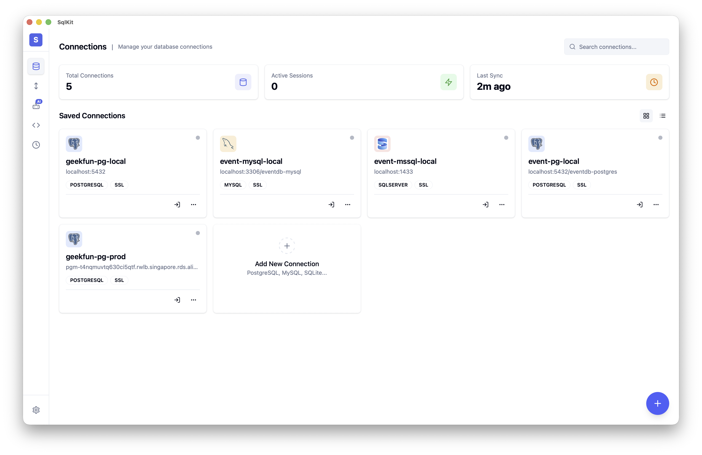

<div align="center">


# SqlKit

**Cliente GUI de banco de dados SQL agêntico e multiplataforma — seu agente de banco de dados para mais de 70 bancos de dados.**

**Privacidade em primeiro lugar. Seus dados, suas chaves. Código aberto.**

[](https://github.com/geek-fun/sqlkit/releases)
[](https://github.com/geek-fun/sqlkit/releases)
[](LICENSE)
[](https://github.com/geek-fun/sqlkit/stargazers)
[](https://github.com/geek-fun/sqlkit/actions/workflows/node.yml)
[](https://mcptoplist.com/server/io.github.geek-fun%2Fdata-studio)

<p>
  
  
  
  
  
</p>

[Baixar](https://www.geekfun.club/download) · [Documentação](docs/DISTRIBUTION.md) · [Site](https://www.geekfun.club) · [Versões](https://github.com/geek-fun/sqlkit/releases)

[English](README.md) · [简体中文](README_zh.md) · Português (BR) · [日本語](README_ja.md) · [한국어](README_ko.md) · [Español](README_es.md)

</div>

---

SqlKit é um **cliente de banco de dados agêntico** — ele não apenas executa SQL, ele entende seus bancos de dados e age em seu nome. Descreva o que você precisa em linguagem natural e o agente escreve consultas, inspeciona esquemas, otimiza SQL e retorna resultados. Construído com Tauri (Rust), e não com Electron, ele substitui clientes pesados como DBeaver, Navicat e DataGrip por um único aplicativo desktop nativo.

<p align="center">
  
</p>

<p align="center">
  
  
  
  
  
  
  
  
  <br/>
  
  
  
  
  
  
  
  
  <br/>
  
  
  
  
  
  
  
  
  
  <br/>
  
  
  
  
  
  
  
  
  <br/>
  
  
  
  
  
  
  
  
  <br/>
  
  
  
  
  
  
  
  
  <br/>
  
  
  
  
  
  
  
  
  <br/>
  
  
  
  
  
  
  
  
  
  
</p>

## Instalação

<a href="https://www.geekfun.club/download">
  <picture>
    <source media="(prefers-color-scheme: dark)" srcset="https://img.shields.io/badge/Download-macOS_|_Windows_|_Linux-orange?logo=download&logoColor=white">
    
  </picture>
</a>
&nbsp;
<a href="https://github.com/geek-fun/sqlkit/releases">
  
</a>
&nbsp;
<a href="https://www.geekfun.club/products/sqlkit/">
  
</a>

## Funcionalidades

### Estúdio de Dados Agêntico

Descreva o que você precisa em linguagem natural — o agente lê seu esquema, escreve consultas, otimiza SQL lentas, explica planos de execução visualmente e corrige erros na hora. Compatível com OpenAI, Anthropic, DeepSeek e Ollama. Traga sua própria chave.

- **Geração de consultas com IA** — de linguagem natural para SQL com contexto ciente do esquema
- **Otimização de SQL** — reescreve consultas lentas e visualiza planos de execução
- **Correção de erros** — o agente diagnostica e corrige erros de SQL automaticamente
- **Segurança** — operações destrutivas exigem confirmação; credenciais nunca expostas ao LLM

### Leve e com desempenho nativo

Construído com Rust + Tauri v2 — sem Electron, sem JRE, sem Chromium embutido. Distribuído como um pequeno binário nativo, com desempenho nativo no macOS, Windows e Linux. O que outros aplicativos precisam de um runtime Java ou de uma licença JetBrains para fazer, o SqlKit faz com um único download.

### Todos os seus bancos de dados, um só aplicativo

O SqlKit suporta **mais de 70 bancos de dados** por meio de quatro estratégias de adaptador:

| Estratégia | Bancos de dados |
|----------|-----------|
| **Nativo** (Rust) | PostgreSQL, MySQL, SQL Server, SQLite |
| **Compatível com protocolo PG** | CockroachDB, Redshift, YugabyteDB, TimescaleDB, QuestDB, Vastbase, YashanDB, KingbaseES, GaussDB, HighGo, UXDB, OpenGauss, GBase8c, Greenplum, EnterpriseDB, CrateDB, Materialize, AlloyDB, CloudSQLPG, FujitsuPG |
| **Compatível com protocolo MySQL** | MariaDB, TiDB, OceanBase, TDSQL, PolarDB, Doris, SelectDB, StarRocks, Databend, GoldenDB, ManticoreSearch, SingleStore, CloudSQLMySQL |
| **Ponte JDBC** | Oracle, DuckDB, Firebird, DB2, H2, Snowflake, TDengine, Derby, Hive, Databricks, Hana, Teradata, Vertica, Exasol, BigQuery, Informix, Kylin, Cassandra, Iris, Access, Dameng, XuguDB, GBase8a |
| **Ponte HTTP** | ClickHouse, Trino, Presto, RQLite, Turso |

### Editor de nível profissional

Baseado no Monaco (motor do VS Code), oferece destaque de sintaxe SQL completo, autocompletar e suporte a múltiplas abas. Navegue pelos esquemas visualmente, inspecione o DDL e pesquise objetos em todos os bancos de dados.

- **Editor Monaco** — edição de SQL de nível VS Code com destaque de sintaxe e autocompletar
- **Múltiplas abas** — trabalhe em várias consultas ao mesmo tempo com gerenciamento de abas
- **Navegador de esquemas** — visualização em árvore de bancos de dados, esquemas, tabelas, colunas e índices
- **Histórico de consultas** — salvo automaticamente, pesquisável e reproduzível
- **Grade de resultados** — paginada, ordenável, com edição em linha e exportação em CSV/JSON/Markdown
- **Visualizador de DDL** — veja as instruções CREATE de qualquer objeto
- **Busca de objetos** — encontre rapidamente tabelas, views e procedures nos esquemas

### Transferência de grandes volumes de dados

Mova dados entre quaisquer engines suportados — PostgreSQL para ClickHouse, Oracle para SQL Server, ou MySQL para BigQuery. Nenhum arquivo intermediário é necessário.

- **Transferência entre engines** — migre dados entre diferentes tipos de banco de dados com mapeamento automático de tipos
- **Importação / Exportação** — formatos CSV, JSON e JSONL
- **Operações em lote** — processe milhões de registros com processamento em lote

### Segurança e conectividade

- **Túnel SSH** — conecte-se via SSH com autenticação por chave ou senha
- **Armazenamento criptografado** — credenciais protegidas pelo chaveiro do sistema operacional (macOS Keychain, Windows Credential Manager, Linux Secret Service)
- **SSL/TLS** — conexões criptografadas para bancos de dados suportados
- **Reconexão automática** — gerenciamento de conexões resiliente

### Multiplataforma

- **macOS** (Apple Silicon e Intel) — instalador nativo `.dmg`
- **Windows** — instalador `.exe`
- **Linux** — pacotes `.AppImage` e `.deb`

## Desenvolvimento

### Pré-requisitos

- [Node.js](https://nodejs.org/) >= 18
- [Toolchain do Rust](https://www.rust-lang.org/tools/install)

**Linux (Ubuntu/Debian):**

```bash
sudo apt-get install -y libgtk-3-dev libwebkit2gtk-4.1-dev libayatana-appindicator3-dev librsvg2-dev libssl-dev
```

**macOS:**

```bash
xcode-select --install
```

**Windows:** Instale o [Microsoft C++ Build Tools](https://visualstudio.microsoft.com/visual-cpp-build-tools/)

### Início rápido

```bash
npm install
npm run tauri dev
```

### Scripts

| Comando | Descrição |
|---------|-------------|
| `npm run dev` | Inicia o servidor de desenvolvimento Vite |
| `npm run build` | Compila o frontend para produção |
| `npm run lint:check` | Executa o ESLint |
| `npm run lint:fix` | Corrige automaticamente os problemas de lint |
| `npm test` | Executa os testes do frontend |
| `npm run tauri dev` | Inicia o desenvolvimento com Tauri |
| `npm run tauri build` | Compila o aplicativo Tauri |

### Instruções de build

Consulte o [BUILD.md](BUILD.md) para ver os requisitos de build específicos de cada plataforma e a solução de problemas.

## Stack tecnológica

| Camada | Tecnologia |
|-------|------------|
| Framework | [Tauri v2](https://tauri.app/) (Rust) |
| Frontend | [Vue 3](https://vuejs.org/) + [TypeScript](https://www.typescriptlang.org/) |
| UI | [shadcn-vue](https://www.shadcn-vue.com/) + [UnoCSS](https://unocss.dev/) |
| Editor | [Monaco Editor](https://microsoft.github.io/monaco-editor/) |
| Banco de dados | [sqlx](https://github.com/launchbadge/sqlx) + drivers específicos de cada engine |

## Perguntas frequentes

<details>
<summary><strong>O SqlKit é gratuito?</strong></summary>

Sim — a **edição Community** é gratuita e de código aberto sob a licença Apache 2.0. Conexões, edição de SQL, navegação de esquemas, edição de dados, histórico de consultas e exportação de resultados são todos gratuitos, sem limites artificiais.

Recursos avançados — agente de IA (traga seu próprio LLM), servidor MCP, diagramas ER, importação/exportação em massa e transferência de dados entre engines — fazem parte da assinatura paga **GEEKFUN Data Studio Ultimate** (US$ 9,90/mês ou US$ 99/ano, com 7 dias de teste gratuito). Todas as versões lançadas enquanto sua assinatura estiver ativa permanecem suas para sempre, mesmo que você cancele depois.

[Ver preços →](https://www.geekfun.club/pricing)
</details>

<details>
<summary><strong>O SqlKit envia dados para servidores externos?</strong></summary>
Não. O SqlKit não coleta telemetria. O recurso de atualização automática verifica novas versões no GitHub Releases — você pode desativá-lo nas configurações. Suas credenciais e consultas ficam na sua máquina.
</details>

<details>
<summary><strong>Posso usar o SqlKit sem conexão com a internet?</strong></summary>
Sim. O aplicativo desktop funciona totalmente offline. Os recursos de IA exigem acesso à rede ao endpoint do modelo (ou um modelo local via Ollama).
</details>

<details>
<summary><strong>Qual é a diferença entre o SqlKit e o DBeaver / TablePlus / DataGrip?</strong></summary>
O SqlKit é um aplicativo Tauri nativo (Rust) — sem Java JRE, sem a sobrecarga do Electron. Inclui IA nativamente (não como plugin), suporta mais de 70 bancos de dados e roda no macOS, Windows e Linux a partir de um único binário. Privacidade em primeiro lugar, com armazenamento local e criptografado das credenciais.
</details>

<details>
<summary><strong>Quais bancos de dados são suportados?</strong></summary>
PostgreSQL, MySQL, Oracle, SQL Server, SQLite, DuckDB, ClickHouse, Firebird, MariaDB, CockroachDB, TiDB, OceanBase, Snowflake, DB2, H2, Trino, Greenplum, CrateDB, SingleStore e mais de 60 outros. Consulte a seção <a href="#multi-database-support">Suporte a múltiplos bancos de dados</a> para ver a lista completa.
</details>

<details>
<summary><strong>Como reporto um bug ou solicito um recurso?</strong></summary>
Abra uma issue no <a href="https://github.com/geek-fun/sqlkit/issues">GitHub Issues</a>.
</details>

## Comunidade

<p align="center">
  
</p>

<p align="center">
  <a href="https://x.com/geekfun_club"></a>
  &nbsp;&nbsp;&nbsp;
  <a href="https://www.youtube.com/@geekfun-club"></a>
  &nbsp;&nbsp;&nbsp;
  <a href="https://github.com/geek-fun"></a>
</p>

## Patrocínio

<p align="center">
  
  &nbsp;&nbsp;&nbsp;&nbsp;&nbsp;
  <a href="https://github.com/sponsors/geek-fun"></a>
</p>

## Licença

[Apache 2.0](LICENSE) © GEEKFUN
